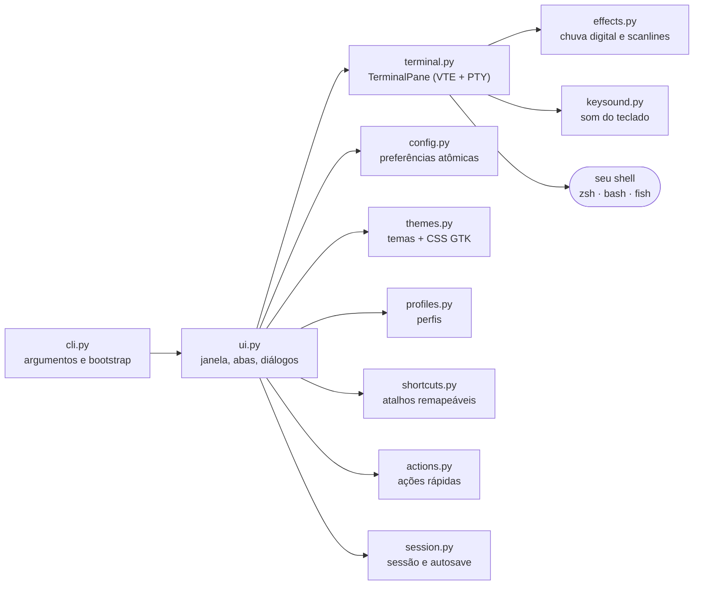
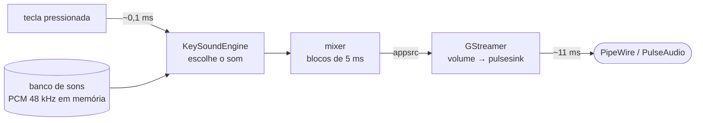

<div align="center">


# Hacker Terminal

**Um terminal nativo para Linux, rápido e totalmente personalizável — com alma retrô.**

GTK 3 · VTE · Python · sem Electron, sem navegador, sem telemetria

[](https://github.com/__OWNER__/hacker-terminal/actions/workflows/ci.yml)
[](https://github.com/__OWNER__/hacker-terminal/releases/latest)
[](LICENSE)


[Instalação](#-instalação) ·
[Recursos](#-recursos) ·
[Personalização](#-personalização) ·
[Como funciona](#-como-funciona) ·
[Solução de problemas](#-solução-de-problemas)

<br>


</div>

---

## 📖 Sumário

- [O que é](#-o-que-é)
- [Recursos](#-recursos)
- [Galeria](#-galeria)
- [Instalação](#-instalação)
- [Primeiros passos](#-primeiros-passos)
- [Atalhos de teclado](#️-atalhos-de-teclado)
- [Personalização](#-personalização)
  - [Temas e editor visual](#temas-e-editor-visual)
  - [Perfis](#perfis)
  - [Som de teclado mecânico](#som-de-teclado-mecânico)
  - [Atalhos personalizados](#atalhos-personalizados)
  - [Ações rápidas](#ações-rápidas)
- [Referência de configuração](#️-referência-de-configuração)
- [Linha de comando](#-linha-de-comando)
- [Como funciona](#-como-funciona)
- [Segurança e privacidade](#-segurança-e-privacidade)
- [Solução de problemas](#-solução-de-problemas)
- [Desenvolvimento](#️-desenvolvimento)
- [Licença](#-licença)

---

## 💡 O que é

O **Hacker Terminal** é um emulador de terminal **de verdade** — não uma simulação. Ele roda o seu shell de login (`zsh`, `bash`, `fish`…) dentro de um PTY usando o **VTE**, o mesmo motor do GNOME Terminal e do Tilix. Por isso `vim`, `tmux`, `htop`, prompts Powerline, cores de 24 bits e programas de tela cheia funcionam exatamente como esperado.

Por cima desse motor maduro, ele adiciona uma camada pensada para quem passa o dia no terminal: abas e painéis divididos, paleta de comandos, temas editáveis, perfis, atalhos remapeáveis, ações rápidas, som de teclado mecânico de baixa latência e, se você quiser, a estética retrô completa — boot animado, chuva digital e scanlines.

> [!NOTE]
> O padrão é **sóbrio** (tema Minimal Dark, sem animações nem som). Toda a parte "hacker" é opcional e fica a um clique no perfil **Retro Hacker**.

---

## ✨ Recursos

<table>
<tr>
<td width="50%" valign="top">

### 🖥️ Terminal
- Shell de login real em PTY (VTE 2.91)
- Abas reordenáveis com títulos dinâmicos
- Divisão horizontal e vertical por aba
- Histórico de 20 mil linhas (até 200 mil)
- Pesquisa no histórico com navegação
- Links clicáveis com `Ctrl+clique`
- Copiar/colar, zoom, tela cheia
- Restauração da sessão e salvamento automático

</td>
<td width="50%" valign="top">

### 🎨 Aparência
- 5 temas internos + temas próprios
- **Editor visual de temas** (interface, terminal e 16 cores ANSI)
- Detecção automática de **Nerd Fonts** e glifos Powerline
- Cursor, negrito e opacidade configuráveis
- Layout responsivo: o painel lateral se recolhe em janelas estreitas
- Efeitos retrô opcionais: boot, chuva digital, scanlines

</td>
</tr>
<tr>
<td valign="top">

### ⚙️ Produtividade
- **Paleta de comandos** (`Ctrl+Shift+P`) com busca
- **Atalhos 100% remapeáveis**, com detecção de conflitos
- **Perfis** que guardam tema, fonte, shell, cursor, diretório e ações
- **Ações rápidas** editáveis no painel lateral
- Barra de status com diretório, branch Git e virtualenv

</td>
<td valign="top">

### 🔊 Som e robustez
- **Som de teclado mecânico**: switches Red, Brown e Blue
- Pacotes gravados (formato **Mechvibes**) para o som exato
- Motor de áudio de ~18 ms de latência
- Confirmação de **colagem perigosa**
- Log rotativo, captura de falhas e modo `--debug`
- Configuração atômica, tolerante a arquivos corrompidos

</td>
</tr>
</table>

---

## 🖼️ Galeria

<div align="center">

**Cinco temas internos** — Minimal Dark, Matrix Green, Cyberpunk Purple, Amber CRT e Ice Blue


<br><br>

**Painéis divididos, abas e pesquisa no histórico**


<br><br>

**Paleta de comandos**


<br><br>

<table>
<tr>
<td align="center"><b>Som do teclado</b><br></td>
<td align="center"><b>Atalhos remapeáveis</b><br></td>
</tr>
<tr>
<td align="center"><b>Perfis personalizados</b><br></td>
<td align="center"><b>Editor de temas</b><br></td>
</tr>
</table>

</div>

---

## 📦 Instalação

### Requisitos

| Componente | Versão | Pacote (Debian/Ubuntu/Kali) | Obrigatório |
| --- | --- | --- | :---: |
| Python | 3.10+ | `python3` | ✅ |
| PyGObject | — | `python3-gi` | ✅ |
| GTK | 3.24 | `gir1.2-gtk-3.0` | ✅ |
| VTE | 2.91 | `gir1.2-vte-2.91` | ✅ |
| GStreamer | 1.x | `python3-gst-1.0`, `gstreamer1.0-plugins-base`, `gstreamer1.0-plugins-good` | 🔊 só para sons |
| Nerd Font | — | ex.: [JetBrainsMono Nerd Font](https://www.nerdfonts.com/) | 💎 recomendada |

Desenvolvido e testado no Kali Linux (XFCE em X11, PipeWire) com GTK 3.24 e VTE 0.84. Deve funcionar em outras distribuições com GTK 3 e VTE 2.91; Wayland ainda não foi testado.

### Opção 1 — Pacote `.deb` (recomendado)

Baixe o arquivo `hacker-terminal_*_all.deb` da [página de releases](https://github.com/__OWNER__/hacker-terminal/releases/latest) e instale com o `apt`, que resolve as dependências sozinho:

```bash
sudo apt install ./hacker-terminal_*_all.deb
```

O terminal aparece no menu de aplicativos e fica disponível como `hacker-terminal`. Para atualizar, instale o `.deb` mais novo da mesma forma; para remover, `sudo apt remove hacker-terminal`.

### Opção 2 — Instalação só para o seu usuário (sem `sudo` para o app)

```bash
sudo apt install python3 python3-gi gir1.2-gtk-3.0 gir1.2-vte-2.91 \
                 python3-gst-1.0 gstreamer1.0-plugins-base gstreamer1.0-plugins-good
git clone https://github.com/__OWNER__/hacker-terminal.git
cd hacker-terminal
./install.sh
```

Instala em `~/.local`, cria o comando `hacker-terminal` e adiciona o atalho ao menu.

```bash
./install.sh --check       # confere a instalação
./install.sh --uninstall   # remove tudo
```

### Opção 3 — Rodar direto do código-fonte

```bash
git clone https://github.com/__OWNER__/hacker-terminal.git
cd hacker-terminal
./run.sh
```

### Opção 4 — Gerar o próprio `.deb`

```bash
make deb                                   # cria dist/hacker-terminal_<versão>_all.deb
sudo apt install ./dist/hacker-terminal_*_all.deb
```

### Verificar a instalação

```bash
hacker-terminal --diagnose
```

```text
Hacker Terminal 0.12.2
GTK: 3.24.52
VTE: 0.84.1
Fonte selecionada: JetBrainsMono Nerd Font
Powerline: OK
Nerd Font: OK
Shell: /usr/bin/zsh
...
```

---

## 🚀 Primeiros passos

1. **Abra** pelo menu de aplicativos ou com `hacker-terminal`.
2. **Escolha um perfil** em `Ctrl+,` → *Geral*: *Desenvolvimento* (sóbrio), *Foco* (sem painel) ou *Retro Hacker* (boot, chuva digital e scanlines).
3. **Experimente a paleta** com `Ctrl+Shift+P` e digite `tema`, `perfil` ou `dividir`.
4. **Divida a tela** com `Ctrl+Shift+D` e alterne entre os painéis com `Ctrl+Shift+O`.
5. **Ligue o som do teclado** em `Ctrl+,` → *Som do teclado* e teste no campo “Digite aqui para ouvir…”.

---

## ⌨️ Atalhos de teclado

Estes são os padrões — **todos podem ser alterados** em *Preferências → Atalhos*.

| Atalho | Ação | | Atalho | Ação |
| --- | --- | --- | --- | --- |
| `Ctrl+Shift+T` | Nova aba | | `Ctrl+Shift+C` | Copiar |
| `Ctrl+Shift+W` | Fechar painel/aba | | `Ctrl+Shift+V` | Colar |
| `Ctrl+Shift+D` | Dividir horizontalmente | | `Ctrl+Shift+F` | Pesquisar no histórico |
| `Ctrl+Shift+E` | Dividir verticalmente | | `Ctrl+Shift+P` | Paleta de comandos |
| `Ctrl+Shift+O` | Alternar painel dividido | | `Ctrl+Shift+B` | Mostrar/ocultar ações |
| `Ctrl+PageDown` | Próxima aba | | `Ctrl+,` | Preferências |
| `Ctrl+PageUp` | Aba anterior | | `F11` | Tela cheia |
| `Ctrl++` / `Ctrl+=` | Aumentar fonte | | `Ctrl+-` | Diminuir fonte |
| `Ctrl+0` | Fonte padrão | | `Ctrl` + roda | Zoom com mouse/touchpad |
| `Ctrl+clique` | Abrir link | | Clique direito | Menu contextual |

Para listar os atalhos em uso (incluindo os seus):

```bash
hacker-terminal --list-shortcuts
```

---

## 🎨 Personalização

Abra as **Preferências** com `Ctrl+,` (ou pelo ícone ⚙). Elas são organizadas em cinco abas:

| Aba | O que você ajusta |
| --- | --- |
| **Geral** | Perfil, shell personalizado, restauração de sessão, painel lateral, colagem segura e aviso de bell |
| **Aparência** | Tema (com editor), fonte, opacidade do fundo, animação de abertura e efeitos visuais |
| **Terminal** | Formato e piscar do cursor, negrito com cores claras, copiar ao selecionar, histórico e rolagem |
| **Som do teclado** | Switch, volume, som ao soltar a tecla, campo de teste e pacotes gravados |
| **Atalhos** | Todas as combinações de teclas, com gravação por tecla e restauração |

### Temas e editor visual

Em **Aparência**, os botões fazem o seguinte:

- **Novo… / Duplicar…** — cria um tema personalizado a partir do selecionado.
- **Editar…** — abre o editor visual (só em temas personalizados; os internos nunca são alterados).
- **Remover** — apaga um tema personalizado.
- **Importar… / Exportar…** — compartilha temas como arquivos `.ini`.

O editor tem seletores de cor para toda a interface, o terminal, a seleção, o cursor, a chuva digital e as **16 cores ANSI**. Os temas ficam em `~/.config/hacker-terminal/themes/` e usam este formato:

<details>
<summary><b>Exemplo de tema (<code>matrix-green.ini</code>)</b></summary>

```ini
[theme]
# id: letras minúsculas, números e hífens
id = matrix-green
name = Matrix Green
author = Hacker Terminal

[interface]
background = #02090b
# surface: cabeçalho, painel e barra de status
surface = #080f14
foreground = #eafff8
# accent: destaques, aba ativa e botões principais
accent = #29ff9a
border = #145c48
# muted: textos secundários
muted = #477b6a
danger = #ff7383

[terminal]
background = #00090b
foreground = #72ffcb
cursor = #e8fff7
selection_background = #12664a
selection_foreground = #ffffff
# 8 cores normais + 8 claras: preto, vermelho, verde, amarelo, azul, magenta, ciano, branco
ansi = #07100f, #ff5b6e, #2de391, #e4d769, #44a8ff, #d779ff, #39d9d0, #c8e6dc, #31534a, #ff7383, #50ffad, #fff083, #72c0ff, #e69aff, #68fff4, #f0fff9

[effects]
matrix_color = #14ff8a
# entre 0 e 1
scanline_opacity = 0.12
```

Arquivos inválidos são ignorados com aviso (veja `--diagnose`) e o terminal volta com segurança ao Minimal Dark.

</details>

> [!TIP]
> A **opacidade do fundo** (30–100%) precisa de um compositor de janelas ativo (o padrão no GNOME, KDE e no XFCE com compositor ligado).

### Perfis

Um perfil guarda um conjunto completo de preferências e pode ser trocado em um clique. Há três perfis internos e você pode criar quantos quiser:

| Perfil | Tema | Destaques |
| --- | --- | --- |
| **Desenvolvimento** | Minimal Dark | Sóbrio, painel de ações visível, sem efeitos |
| **Foco** | Ice Blue | Fonte maior, sem painel lateral |
| **Retro Hacker** | Matrix Green | Boot animado, chuva digital e scanlines |
| *Seus perfis* | qualquer um | Tema, fonte, tamanho, shell, cursor, opacidade, efeitos, painel, **diretório inicial** e **ações rápidas próprias** |

**Para criar:** ajuste tudo nas Preferências e clique em *Geral → **Salvar como perfil…***, ou use a paleta (*“Salvar configurações atuais como perfil”*). Ative **Ações rápidas próprias** para que o perfil tenha uma lista separada de ações (por exemplo, comandos do seu laboratório de testes), que troca automaticamente junto com o perfil.

```bash
hacker-terminal --list-profiles
hacker-terminal --profile pentest     # abre direto com um perfil
```

<details>
<summary><b>Formato do arquivo de perfil</b></summary>

`~/.config/hacker-terminal/profiles/pentest.ini`

```ini
[profile]
id = pentest
name = Pentest Lab
description = Laboratório autorizado
theme = matrix-green
font = JetBrainsMono Nerd Font Mono
font_size = 12
shell = zsh
cursor_shape = ibeam
opacity = 92
boot = false
effects = true
sound = true
panel_visible = true
working_directory = ~/labs
# usa a lista de ações em profiles/pentest.actions
own_actions = true
```

</details>

### Som de teclado mecânico

Em **Preferências → Som do teclado**, ative o som e escolha o switch. Cada som é **sintetizado a partir dos eventos físicos** do switch — o clique da jaqueta, o *bump* tátil, a batida no fundo do curso (*bottom-out*), o retorno da haste (*top-out*) e os estabilizadores das teclas grandes.

| Switch | Caráter | O que você ouve | Amostra |
| --- | --- | --- | --- |
| 🔴 **Linear** (estilo Red) | suave | batida no fundo e retorno, sem clique | [▶ ouvir](docs/audio/switch-red.mp3) |
| 🟤 **Tátil** (estilo Brown) | discreto | um tique leve antes da batida | [▶ ouvir](docs/audio/switch-brown.mp3) |
| 🔵 **Clicky** (estilo Blue) | barulhento | clique agudo na descida **e** na subida | [▶ ouvir](docs/audio/switch-blue.mp3) |

Detalhes que deixam o som natural:

- **Descida e subida** da tecla têm sons diferentes (o retorno é mais agudo, como no real).
- **Espaço, Enter, Backspace, Shift e Tab** soam mais graves e com o chocalho dos estabilizadores.
- Cada tecla tem **variações próprias**, para não soar repetitivo.
- **Segurar uma tecla não repete o som** (o auto-repeat é silencioso, como num teclado de verdade).
- Latência total medida de **~18 ms** no PipeWire — abaixo do perceptível.

#### Som exato com gravações reais

Os sons sintetizados são aproximações. Para o som **idêntico** a um teclado real, use **Importar pacote…** com:

1. **Pacotes do [Mechvibes](https://mechvibes.com/)** — a pasta com `config.json` (tipos `single` e `multi`). Há pacotes gravados de Cherry MX Red, Brown, Blue e muitos outros; cada tecla física usa o som definido para ela.
2. **Uma pasta com suas próprias gravações** (WAV, OGG, MP3, FLAC ou Opus), nomeadas assim:

| Arquivo | Quando toca |
| --- | --- |
| `press.wav`, `press2.wav`, … | descida de uma tecla comum (várias = variação) |
| `release.wav`, `release2.wav`, … | subida de uma tecla comum |
| `space-press.wav`, `space-release.wav` | barra de espaço |
| `enter-press.wav`, `enter-release.wav` | Enter |
| `large-press.wav`, `large-release.wav` | Backspace, Shift, Tab, Caps Lock |

`down`/`up` também são aceitos no lugar de `press`/`release`. Os pacotes ficam em `~/.local/share/hacker-terminal/soundpacks/` (o botão **Abrir pasta** leva até lá).

### Atalhos personalizados

Em **Preferências → Atalhos**, clique em um atalho e pressione a nova combinação. `Backspace` desativa, `Esc` cancela e o botão ↺ volta ao padrão. Conflitos são avisados na hora. Também é possível editar direto no `config.ini`, usando a sintaxe do GTK:

```ini
[shortcuts]
# Ctrl+T abre uma nova aba
new_tab = <Primary>t
# ";" separa várias combinações para a mesma ação
copy = <Primary><Shift>c;<Primary>Insert
# vazio desativa o atalho
fullscreen =
```

> [!IMPORTANT]
> Nos arquivos `.ini`, escreva comentários em **linhas próprias** (começando com `#` ou `;`); um comentário no fim da linha passa a fazer parte do valor.

Identificadores disponíveis: `new_tab`, `close_pane`, `split_horizontal`, `split_vertical`, `focus_other_pane`, `next_tab`, `previous_tab`, `copy`, `paste`, `search`, `command_palette`, `toggle_panel`, `preferences`, `zoom_in`, `zoom_out`, `zoom_reset`, `fullscreen`.

### Ações rápidas

O painel lateral traz comandos de diagnóstico local (identidade, interfaces de rede, portas, rotas, processos, SSH, saúde do sistema). Em **Editar ações…** você adiciona, edita, remove e reordena — por exemplo `make test`, `docker ps` ou `git status` — e pode exigir **confirmação** antes de ações sensíveis (marcadas com ●). Todas as ações também aparecem na paleta de comandos.

---

## 🗂️ Referência de configuração

### Onde ficam os arquivos

| Caminho | Conteúdo |
| --- | --- |
| `~/.config/hacker-terminal/config.ini` | Preferências e atalhos |
| `~/.config/hacker-terminal/actions.ini` | Ações rápidas compartilhadas |
| `~/.config/hacker-terminal/session.json` | Abas, painéis e diretórios da última sessão |
| `~/.config/hacker-terminal/themes/` | Temas personalizados (`.ini`) |
| `~/.config/hacker-terminal/profiles/` | Perfis (`.ini`) e ações próprias (`.actions`) |
| `~/.local/share/hacker-terminal/soundpacks/` | Pacotes de som gravados |
| `~/.cache/hacker-terminal/keysounds/` | Cache dos sons sintetizados |
| `~/.local/state/hacker-terminal/hacker-terminal.log` | Log de diagnóstico (rotativo) |

Os caminhos respeitam `XDG_CONFIG_HOME`, `XDG_DATA_HOME`, `XDG_CACHE_HOME` e `XDG_STATE_HOME`. Todos os arquivos são gravados de forma **atômica** e com permissão `0600`.

<details>
<summary><b>Todas as chaves de <code>[terminal]</code> no <code>config.ini</code></b></summary>

| Chave | Valores | Padrão | Descrição |
| --- | --- | --- | --- |
| `profile` | id de perfil | `developer` | Perfil ativo |
| `theme` | id de tema | `minimal-dark` | Tema ativo |
| `font` | família | *(automática)* | Fonte; vazio escolhe a melhor Nerd Font instalada |
| `font_size` | 6–32 | `11` | Tamanho da fonte |
| `scrollback_lines` | 1000–200000 | `20000` | Linhas de histórico |
| `cursor_shape` | `block`, `ibeam`, `underline` | `block` | Formato do cursor |
| `cursor_blink` | `system`, `on`, `off` | `system` | Piscar do cursor |
| `opacity` | 30–100 | `100` | Opacidade do fundo (%) |
| `bold_is_bright` | booleano | `false` | Negrito usa a cor clara |
| `copy_on_select` | booleano | `false` | Copia ao selecionar |
| `scroll_on_output` | booleano | `false` | Rola ao receber saída |
| `scroll_on_keystroke` | booleano | `true` | Rola ao digitar |
| `shell` | comando | *(login shell)* | Ex.: `fish` ou `bash --norc` |
| `confirm_paste` | booleano | `true` | Confirma colagens perigosas |
| `bell_notify` | booleano | `true` | Marca aba/janela no bell |
| `panel_visible` | booleano | `true` | Painel de ações |
| `restore_session` | booleano | `true` | Restaura abas ao abrir |
| `boot` | booleano | `false` | Animação de abertura |
| `effects` | booleano | `false` | Chuva digital e scanlines |
| `sound` | booleano | `false` | Som do teclado |
| `key_switch` | `red`, `brown`, `blue`, `pack:<pasta>` | `brown` | Som do switch |
| `key_volume` | 0–100 | `70` | Volume do teclado |
| `key_release` | booleano | `true` | Som ao soltar a tecla |

Valores inválidos são normalizados para o padrão; seções desconhecidas são preservadas ao salvar.

</details>

### Variáveis de ambiente

| Variável | Efeito |
| --- | --- |
| `HACKER_TERMINAL_FONT` | Força uma família de fonte |
| `HACKER_TERMINAL_BOOT` / `_EFFECTS` / `_SOUND` | `0`, `false`, `no` ou `off` desligam o recurso |
| `HACKER_TERMINAL_AUDIO_SINK` | Força um elemento de saída do GStreamer (ex.: `pipewiresink`, `fakesink`) |

---

## 💻 Linha de comando

```text
hacker-terminal [opções] [-e COMANDO ...]
```

| Opção | Descrição |
| --- | --- |
| `-e`, `--execute COMANDO…` | Executa um comando no lugar do shell (ex.: `-e htop`) |
| `--working-directory DIR` | Diretório inicial |
| `--profile ID` / `--list-profiles` | Usa um perfil / lista os perfis |
| `--theme ID` / `--list-themes` | Usa um tema / lista os temas |
| `--font FAMÍLIA`, `--font-size N` | Fonte e tamanho só nesta janela |
| `--no-boot`, `--no-effects`, `--no-sound`, `--no-panel` | Desliga recursos nesta janela |
| `--list-shortcuts` | Lista os atalhos em uso |
| `--diagnose` | Verifica dependências, fonte, tema, perfil e atalhos |
| `--debug` | Mensagens detalhadas no terminal e no log |
| `--version` | Mostra a versão |

---

## 🔧 Como funciona

### Arquitetura



| Módulo | Responsabilidade |
| --- | --- |
| `cli.py` | Analisa argumentos, aplica perfil/tema, configura o log e inicia o `Gtk.Application` |
| `ui.py` | Janela principal, abas, painéis, cabeçalho, barra de status e todos os diálogos |
| `terminal.py` | Painel VTE: spawn do shell, pesquisa, links, colagem segura, bell, zoom |
| `themes.py` | Carrega e valida temas, gera o CSS do GTK, salva temas personalizados |
| `shortcuts.py` | Lê, valida, casa e rotula atalhos (sem depender de display) |
| `keysound.py` | Síntese dos switches, pacotes gravados e o mixer de áudio |
| `config.py`, `profiles.py`, `session.py`, `actions.py` | Persistência atômica de preferências, perfis, sessão e ações |
| `effects.py` | Desenha a chuva digital e as scanlines por cima do VTE |
| `fonts.py`, `project.py`, `logs.py` | Detecção de Nerd Fonts, contexto Git/venv e log rotativo |

### O terminal

Cada painel é um `Vte.Terminal` que inicia o shell de login em um PTY próprio (`$SHELL -l`, ou o shell configurado; se ele falhar, o terminal volta automaticamente ao shell padrão). Quando o shell informa o diretório atual pela sequência OSC 7 (o `vte.sh` do sistema faz isso no bash e no zsh), novas abas **herdam o diretório** e a sessão é restaurada nas pastas certas; sem OSC 7, elas abrem no diretório inicial. A barra de status lê o branch Git e o virtualenv diretamente do sistema de arquivos, sem iniciar processos.

Os efeitos retrô são desenhados **depois** do VTE, no mesmo widget — sem camadas por cima — para que cliques, toques e a rolagem do touchpad continuem chegando ao terminal.

### O motor de som



- Os sons são **pré-calculados** (ou decodificados, no caso de pacotes) para PCM 48 kHz mono e mantidos em memória, com cache em disco.
- A saída é **uma única stream contínua**: o mixer entrega um bloco de 5 ms a cada 5 ms — silêncio ou a mistura das teclas em andamento. Uma tecla nova entra no bloco seguinte, sem abrir ou reiniciar nada.
- Após 15 s sem digitar, a stream é pausada para que o dispositivo de áudio possa dormir; a retomada leva poucos milissegundos.

<details>
<summary><b>Como os switches são sintetizados</b></summary>

Cada evento físico vira um **impacto** que excita um conjunto de **modos de ressonância** (filtros de dois polos com decaimento exponencial), normalizados pelo próprio pico para que os níveis declarados sejam os níveis reais:

| Evento | Modos principais | Usado em |
| --- | --- | --- |
| Clique da jaqueta | 3,9 / 6,3 / 9,1 kHz, decaimento de 1–2,5 ms | Blue (descida e subida) |
| *Bump* tátil | 2,3 / 5,2 kHz, muito curto e fraco | Brown |
| Fundo do curso | 310 Hz – 4,7 kHz (corpo, keycap e haste) | todos |
| Retorno da haste | 760 Hz – 5,6 kHz, mais agudo | todos (subida) |
| Estabilizador | 2,1 / 3,1 / 4,7 kHz, pequenos chocalhos | Espaço, Enter, Shift, Backspace, Tab |

Teclas maiores reduzem a frequência e alongam o decaimento; pequenas variações aleatórias de tempo, frequência e amplitude evitam o efeito “metralhadora”.

</details>

---

## 🔒 Segurança e privacidade

- **Sem rede:** nenhuma telemetria, nenhum acesso externo, nenhuma dependência do PyPI.
- **Colagem segura:** textos com várias linhas ou caracteres de controle ocultos pedem confirmação antes de chegar ao shell (respeitando o *bracketed paste*).
- **Links:** só esquemas `http`, `https`, `ftp` e `file` são reconhecidos, e só abrem com ação explícita (`Ctrl+clique` ou menu).
- **Sessão:** apenas o tamanho da janela, a aba ativa e diretórios locais são salvos — nunca o conteúdo do terminal ou os processos.
- **Arquivos:** gravação atômica com permissão `0600`; pacotes de som rejeitam caminhos fora da própria pasta e links simbólicos.
- **Ações rápidas:** as ações padrão são locais e defensivas. Use ferramentas de segurança apenas em sistemas próprios ou com autorização explícita.

---

## 🩺 Solução de problemas

<details>
<summary><b>Ícones do prompt aparecem como quadrados</b></summary>

Instale uma Nerd Font (por exemplo, a JetBrainsMono Nerd Font) e confira com `hacker-terminal --diagnose`. O terminal detecta a fonte sozinho; para forçar uma, use *Preferências → Aparência → Fonte* ou `--font "JetBrainsMono Nerd Font Mono"`.

</details>

<details>
<summary><b>Não sai som do teclado</b></summary>

1. Confirme que o som está ligado em *Preferências → Som do teclado* e teste no campo de digitação.
2. Instale os plugins: `sudo apt install python3-gst-1.0 gstreamer1.0-plugins-base gstreamer1.0-plugins-good`.
3. Veja a linha de status abaixo do seletor de switch e o log em `~/.local/state/hacker-terminal/hacker-terminal.log`.
4. Se a saída padrão não for a esperada, force o elemento: `HACKER_TERMINAL_AUDIO_SINK=pipewiresink hacker-terminal`.

</details>

<details>
<summary><b>A transparência não funciona</b></summary>

A opacidade precisa de um compositor. No XFCE, ative em *Ajustes do gerenciador de janelas → Compositor*. As Preferências indicam se a transparência está disponível.

</details>

<details>
<summary><b>A rolagem do touchpad não funciona</b></summary>

Atualize para a versão 0.11.1 ou mais nova — versões anteriores bloqueavam a rolagem quando os efeitos visuais estavam ligados. Se persistir, rode com `--debug` e abra uma *issue* com o log.

</details>

<details>
<summary><b>As preferências voltaram ao padrão</b></summary>

Rode `hacker-terminal --diagnose`: ele aponta temas, perfis e atalhos inválidos. O arquivo `config.ini` é validado ao abrir; valores inválidos voltam ao padrão sem impedir a abertura.

</details>

---

## 🛠️ Desenvolvimento

```text
hacker-terminal/
├── hacker_terminal.py        # ponto de entrada
├── hackerterminal/           # código do aplicativo (módulos descritos acima)
│   └── themes/               # temas internos (.ini)
├── tests/
│   ├── test_core.py          # testes unitários (sem display)
│   ├── gui_smoke.py          # teste de integração GTK/VTE (Xvfb)
│   └── smoke.sh              # suíte completa: testes, instalação e .deb
├── packaging/                # build do .deb e metadados AppStream
├── assets/                   # ícone e arquivo .desktop
├── docs/                     # capturas de tela e amostras de áudio
├── install.sh · run.sh · Makefile
```

```bash
make check       # testes unitários, instalação, pacote e (com display) teste gráfico
make check-gui   # inclui o teste gráfico usando Xvfb
make run         # roda a partir do código-fonte
make deb         # gera dist/hacker-terminal_<versão>_all.deb
```

O projeto **não usa dependências do PyPI**: PyGObject, GTK, VTE e GStreamer vêm do sistema. A suíte roda o áudio em `fakesink` (sem fazer barulho), e o teste gráfico inclui eventos reais do X via `xdotool` para cobrir a rolagem. O GitHub Actions executa tudo a cada *push* e *pull request*.

Contribuições são bem-vindas — leia o [CONTRIBUTING.md](CONTRIBUTING.md). O histórico de versões está no [CHANGELOG.md](CHANGELOG.md) e as decisões técnicas e correções no [AUDIT.md](AUDIT.md).

---

## 📄 Licença

Distribuído sob a licença [MIT](LICENSE).

<div align="center">
<sub>Feito com GTK, VTE e muitas horas de terminal. ⌨️</sub>
</div>
